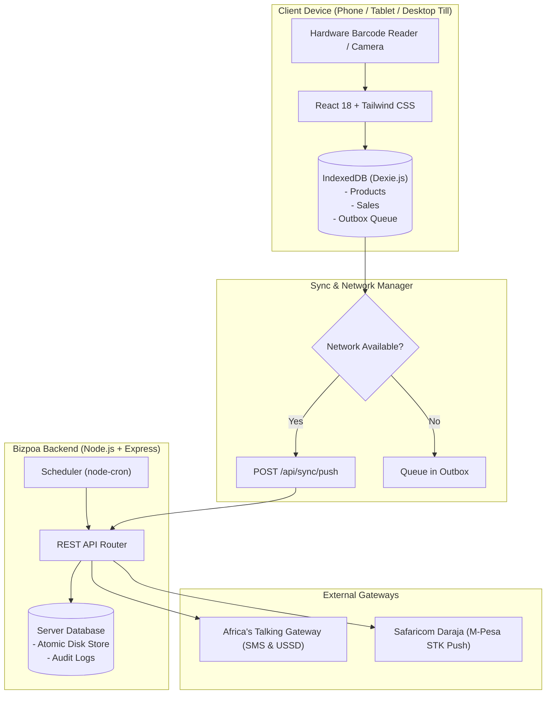

# Bizpoa POS 🏪

[](https://opensource.org/licenses/MIT)
[](https://nodejs.org/)
[](https://web.dev/progressive-web-apps/)
[](https://africastalking.com/)
[](https://developer.safaricom.co.ke/)

> **Production-grade, offline-first Point of Sale (POS) designed for African retail stores, dukas, and kiosks.**
> Features offline transaction queues, Safaricom Daraja M-Pesa STK push, Africa's Talking digital SMS receipts, camera/USB barcode scanning, and GSM USSD (`*384*5012#`) integration for basic feature phones.

---

## 🌟 Key Highlights

- 📶 **100% Offline-First Architecture**: Powered by client-side IndexedDB (`Dexie.js`) and an outbox queue. Sales, inventory adjustments, and digital receipts continue operating without an internet connection, and automatically sync to the server when reconnected.
- 💳 **Kenyan Multi-Tender Checkout**:
  - **Cash**: Preset quick amount buttons (Exact, nearest KES 100, 500, 1000) with automatic change computation and insufficient tender warnings.
  - **M-Pesa**: Direct Buy Goods Till prompt plus instant Lipa Na M-Pesa Online (STK Push) prompt directly to the customer's handset.
  - **Card**: PDQ / bank POS transaction tracking.
- 📱 **Africa's Talking SMS & USSD**:
  - Itemized digital receipt dispatch via Africa's Talking SMS API.
  - Automated evening closing sales summary SMS sent to the shop owner at a configured time.
  - Interactive **USSD Webhook Engine** (`*384*5012#`) enabling shop owners to query daily income, previous day sales, last 5 transactions, and low stock warnings from any non-smartphone (Nokia, itel, etc.).
- 📟 **Feature Phone LCD Simulator**: Built-in interactive simulator with a retro green matrix LCD and a 3x4 physical keypad to test USSD code navigation without needing real GSM airtime.
- 📷 **Dual-Mode Barcode Scanning**:
  - **Camera Scanner**: Integrated HTML5 video / canvas scanner with real-time red laser viewfinder animation.
  - **Hardware HID USB/Bluetooth Readers**: Auto-detects rapid keystroke bursts ending in `Enter` from handheld laser scanners without requiring input field focus.
  - **Sell Mode**: Scans items straight into the cart with audio beep and haptic feedback.
  - **Receive Mode**: Increments inventory stock in batches (+1, +6, +12, +24).
- 📦 **Inventory & Stock Management**:
  - High-contrast product tiles with dynamic category color hues and letter monograms.
  - Automated sold-out archiving when stock reaches 0 units.
  - Single-click **Restock** button to bring sold-out items back into the active catalog.
  - Low stock warning badges on the bottom navigation tab.
- 🖨️ **Thermal Receipt Generator**:
  - Authentic 58mm / 80mm thermal receipt format with dashed line dividers and Swahili blessing ("Asante sana, karibu tena!").
  - Instant printing with dedicated `@media print` thermal printer styles.

---

## 🏗️ Architecture Overview



---

## 💻 Tech Stack

### Frontend Client (`client/`)
- **Framework**: React 18, TypeScript, Vite
- **Styling**: Tailwind CSS, Lucide React Icons
- **Offline Storage**: Dexie.js (IndexedDB)
- **Audio & Haptics**: Web Audio API (Oscillator synthesis) & `navigator.vibrate`
- **PWA**: Service Worker caching, `manifest.json`

### Backend Server (`server/`)
- **Runtime**: Node.js 20+, Express, TypeScript
- **Database**: Atomic ACID Disk-backed JSON Store with migration and seeding
- **Task Scheduling**: `node-cron` for automated closing reports
- **Testing**: Jest, Supertest, ts-jest
- **Gateways**: Africa's Talking REST API, Safaricom Daraja Lipa Na M-Pesa Online

---

## 🚀 Quick Start Guide

### Prerequisites
- Node.js (version 20 or higher)
- npm (version 9 or higher)

### 1. Clone & Install Dependencies

```bash
git clone https://github.com/gitWithMaryke/bizpoa-pos.git
cd bizpoa-pos

# Install root dependencies
npm install

# Install server dependencies
cd server
npm install

# Install client dependencies
cd ../client
npm install
cd ..
```

### 2. Configure Environment Variables

Create `.env` inside `server/`:

```env
PORT=5050
NODE_ENV=development

# Shop Configuration
SHOP_NAME=Mama Njeri Duka
TILL_NUMBER=5012345
OWNER_PHONE=+254722000111
CURRENCY=KES
DAILY_REPORT_TIME=20:00

# Africa's Talking Credentials (Optional for local testing)
AT_USERNAME=sandbox
AT_API_KEY=atsk_your_api_key_here
AT_SENDER_ID=
AT_IS_SANDBOX=true

# Safaricom Daraja M-Pesa (Optional)
MPESA_ENV=sandbox
MPESA_CONSUMER_KEY=
MPESA_CONSUMER_SECRET=
MPESA_PASSKEY=
MPESA_SHORTCODE=174379
```

### 3. Run Development Servers

Run backend and frontend concurrently:

```bash
# In the root directory:
npm run dev

# Or run separately:
# Terminal 1 (Backend API on http://localhost:5050):
npm run dev:server

# Terminal 2 (Frontend Client on http://localhost:3000):
npm run dev:client
```

Open `http://localhost:3000` in your web browser or mobile browser.

---

## 🐳 Docker Deployment

You can deploy the entire client and server suite using Docker Compose:

```bash
docker compose up --build -d
```

- **Frontend Client**: `http://localhost:80`
- **Backend API**: `http://localhost:5050`

---

## 📲 Africa's Talking USSD Configuration

Bizpoa POS comes with a ready-to-deploy USSD webhook handler compliant with Africa's Talking USSD protocol.

1. Sign up on [Africa's Talking](https://account.africastalking.com/).
2. Create a USSD Service Code (e.g., `*384*5012#`).
3. Set the Callback URL to:
   ```
   https://your-domain.com/api/ussd
   ```
4. Method: `POST`

### USSD Menu Tree:
```
*384*5012#
├── 1. Today's Sales Summary (Gross KES, receipts, cash vs mpesa)
├── 2. Yesterday's Sales Summary
├── 3. Last 5 Transactions (Receipt #, time, amount, payment method)
├── 4. Low Stock Alerts (Products with <= 5 units)
├── 5. Request Daily SMS Report (Triggers instant SMS to caller)
└── 0. Exit
```

---

## 🧪 Running Automated Tests

Run backend API and USSD protocol integration tests:

```bash
cd server
npm test
```

Expected output:
```
 PASS  tests/api.test.ts
  Bizpoa POS Server API Tests
    ✓ GET /api/health returns healthy status (18 ms)
    ✓ GET /api/products returns product inventory (12 ms)
    ✓ POST /api/sales creates a sale and reduces stock (24 ms)
    ✓ POST /api/ussd handles Africa's Talking USSD protocol (15 ms)

Test Suites: 1 passed, 1 total
Tests:       4 passed, 4 total
```

---

## 📄 License

This project is licensed under the MIT License - see the [LICENSE](LICENSE) file for details.

Developed with ❤️ by **Mary Ndanu** (`gitWithMaryke`).
